# WorldFoundry 架构设计文档

> 版本:0.1.0(Phase-1 ~ Phase-5 + M2/M3 后端矩阵演进中)
> 日期:2026-08-21
> 关联文档:`architecture-analysis.md`(现状分析)、`docs/superpowers/specs/2026-07-27-ascend-world-model-design.md`(设计规格)、`docs/roadmap/2026-08-14-opensource-extensions-loop-todo.md`(演进路线)

> **设计定位一句话**:核心是**世界模型平台**,不是某个特定 JEPA 模型——预测式(JEPA 家族)与生成式(VAE/DiT 扩散)双家族并载,JEPA 是当前主实现的预测式家族,生成式解码侧已可独立训练。

---

## 1. 设计目标与约束

### 1.1 设计目标

| # | 目标 | 落地方式 |
|---|---|---|
| G1 | **CPU-NPU 同构** | 单一代码路径,`resolve_device()` 统一设备解析,CPU 上可完整跑通全链路 |
| G2 | **外部框架可插拔** | 协议适配器(InferenceWorker / RolloutWorker / TrainingRunner)+ 五轴后端插件系统 |
| G3 | **版本强锁定** | 版本锁定矩阵(torch/torch_npu/transformers/vllm-ascend 等),运行时校验 |
| G4 | **快速回归反馈** | TinyVJEPA2(~80K 参数)CPU RTI smoke,单线程 ~3.5s 端到端验证 |
| G5 | **引擎可审计** | 每次运行记录 `inference_engine_dispatched` / `policy_bootstrap.rlinf_*` 结构化指纹 |
| G6 | **演进不破坏契约** | `LatentToFramePipeline` 等接口冻结,v1(CPU)→ v2(NPU/MindIE-SD)无缝切换 |
| G7 | **训推渲一体** | 训练框架 / 推理引擎 / 仿真环境**三支柱同级**,`sim_env` 轴与 `training` / `inference` 同层级可插拔 |
| G8 | **世界模型双家族并载** | 预测式(JEPA 家族:EMA + masked 目标)与生成式(VAE/DiT 扩散:KL 重建 + 解码生成)**两条独立训练路径并存**,encoder 与 decoder 解耦 |

### 1.2 约束条件

- 仅部署于 **Ascend NPU 基础镜像** `ascend-pytorch:2.9.0-cann8.5.1-ubuntu22.04`(自带 torch 2.9.0+cpu 与 torch_npu 2.9.0)
- Python `==3.11.*`;`numpy<2.0`
- 主版本 pin:torch 2.9.0 / torch_npu 2.9.0 / transformers 4.55.0 / peft 0.18.0 / accelerate 1.14.0 / vllm-ascend 0.18.0 / triton 3.7.1 / datasets 3.6.0
- 可选依赖分区:`[train]`(deepspeed)、`[inf]`(vllm-ascend)、`[rl]`(verl+ray)、`[quant]`(msmodelslim)、`[video]`(av+decord+opencv)、`[diffusion]`(diffusers)、`[vllm_omni]`(ORT 替身)
- 外部公共 wheel 未发布时的策略:提供**真实可执行的 CPU 替身**(如 vllm-omni = ORT encoder + ORT diffusion),接口先行,替身可审计

### 1.3 设计定位:世界模型平台,而非"仅 JEPA 平台"

项目的核心壁垒是"**以世界模型为 policy + 训推渲一体编排**",不是某个特定 JEPA 模型。耦合分层:

| 层 | 现状 | 解耦程度 |
|---|---|---|
| 训练目标 | `jepa_objective.py`(EMA + masked)JEPA 专用;`scripts/train_vae.py`(KL 重建)生成式专用 | ✅ 两条独立训练路径已并存 |
| encoder 轴 | `model` 轴注册 `self/tiny` 与 `transformers/hf_vjepa2`,均为 V-JEPA 2 家族 | 🟡 shim surface 原理上允许任意 encoder,当前注册均为 JEPA |
| 解码/生成侧 | `LatentToFramePipeline` + VAE/DiT/scheduler(`M3-T6` 已 Atlas 验收) | ✅ 家族无关,任意 latent 可喂入 |
| rollout/plan | `latent_rollout.py` + action predictor + `/v1/world/plan`;diffusion `rollout` 已存在 | 🟡 偏 JEPA 隐变量路线,生成式可复用 decoder |
| RL/推理/编排 | PPO、`--inference-backend`、`--rl-backend`、`--env` 各轴 | ✅ 完全家族无关 |

**结论**:架构 seam(model 轴、`LatentToFramePipeline`、VAE 训练脚本)已为生成式家族留位且部分落地;JEPA 是**当前默认的世界模型家族,不是平台的边界**。

---

## 2. 总体架构设计

### 2.1 分层架构总览

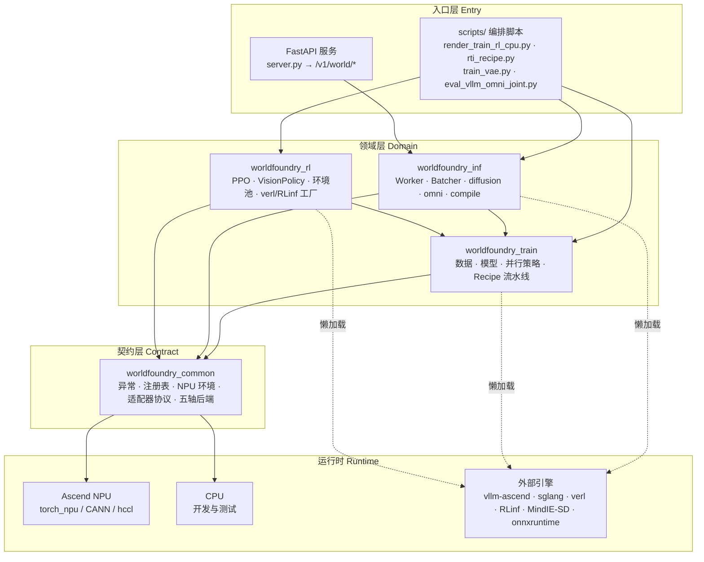

### 2.2 包依赖 DAG

四包之间构成**单向依赖**,`worldfoundry_common` 为最底层契约,**禁止反向依赖**:

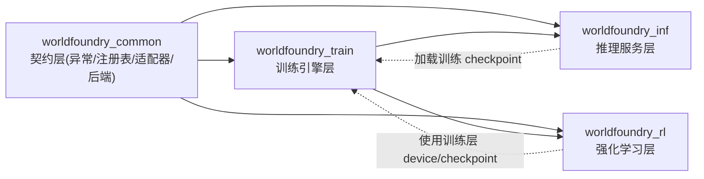

依赖方向原则:上层可依赖下层,同层不循环;`common` 不依赖任何业务包。

### 2.3 模块职责总表

| 包 | 顶层模块 | 职责 |
|---|---|---|
| common | `exceptions.py` | `WorldFoundryError` 领域异常层次(VersionMismatch / ModelNotFound / OMCompile) |
| common | `model_registry.py` | 模型注册表,支持本地路径 / HF Hub 回退 |
| common | `npu_env.py` | 设备检测、版本锁定校验、hccl 分布式初始化 |
| common | `adapters/` | 外部框架接入协议 + verl / rlinf / sglang 懒加载适配器 |
| common | `backends/` | 五轴后端插件系统(device/training/inference/model/sim_env) |
| train | `recipe/` | RTI 声明式流水线:config + stages + backends 注册表 + pipeline |
| train | `parallel/` | DDP / FSDP / MindSpeed-MM,统一 `DistributedStrategy` |
| train | `model/` | TinyJEPA / Predictor / temporal / action / EMA / LoRA / hf shim / latent_rollout |
| train | `jepa_objective.py` | JEPA 训练目标(online + EMA target + loss) |
| train | `training_loop.py` | 训练循环(前向/反向/梯度累积/分布式 step) |
| inf | `server.py` + `api/` | FastAPI 应用与 /encode /predict /plan 路由 |
| inf | `workers/` | VJEPA2Worker(torch)/ VJEPA2NPUWorker(vllm)/ OnnxVJEPAWorker(ORT) |
| inf | `predict_batcher.py` | 动态批处理(max_batch + max_latency_ms) |
| inf | `diffusion/` | LatentToFramePipeline + vae/transformer/scheduler/backends |
| inf | `omni/` | vLLM-Omni 统一多模态流水线(encode/decode/rollout/plan) |
| inf | `compile/` | 量化 facade(W8A8/W8A16/W4A16)+ MindIE-SD OM 编译 |
| rl | `ppo.py` | 自研 PPO(GAE + clipped surrogate),作为 verl/RLinf 正确性 baseline |
| rl | `vision_policy.py` | 可插拔编码器 Actor-Critic(state / Tiny / HF+LoRA) |
| rl | `env_*.py` + `env_pool.py` | Mock / FrankaKitchen / Manipulator / DROID + 向量化环境池 |
| rl | `rlinf_factory.py` / `verl_factory.py` | RLinf v0.3+ / verl 框架工厂 |

---

## 3. 核心机制设计

### 3.1 五轴后端插件系统

`worldfoundry_common.backends` 提供统一注册-发现-构建机制,每个轴独立注册表,全部懒加载:

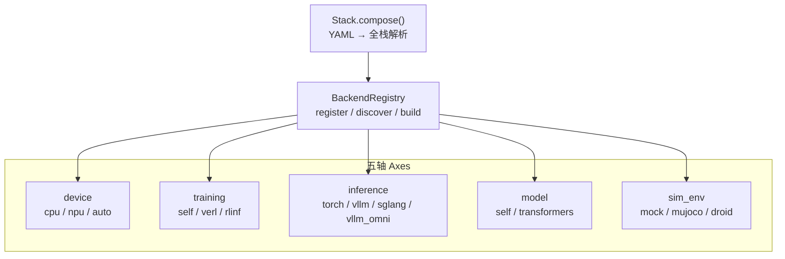

设计要点:

- 每个 backend **延迟导入**(lazy import),可选依赖未安装时不污染导入路径
- `Stack.compose()` 支持从 YAML 配置一键解析全栈
- 外部框架接入只需新增一个 backend 注册项,不改调用方

**训推渲一体**:五轴中 `training` / `inference` / `sim_env` 是**三大同级业务支柱**,分别对应"训 / 推 / 渲(仿真环境)";`device` / `model` 是支撑轴。`sim_env` 与训练框架、推理引擎**同层级**——仿真环境是独立一等公民,不是 RL 层的附属模块:其工厂契约 `build(**kwargs) → env factory`(无参 callable)由 `SyncEnvPool` 消费,`resolve_env_spec` 支持 YAML 别名(如 `franka_kitchen` → `worldfoundry_rl.env_franka_kitchen:FrankaKitchenEnv`),经 `--env` / `env_type` 在编排层与 inference / rl 同等 dispatch。

### 3.2 协议适配器层(外部框架接入契约)

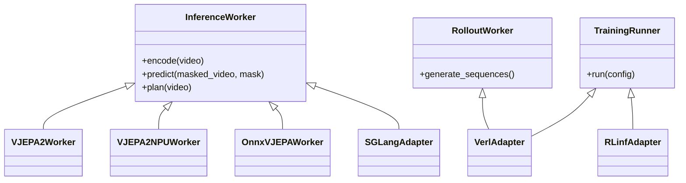

三个协议分别对应**推理服务**(encode/predict/plan)、**仿真回滚**(generate_sequences)、**框架训练**(run(config)),是 verl / rlinf / sglang / vllm 的可插拔替换点。

### 3.3 设备抽象层(W20)

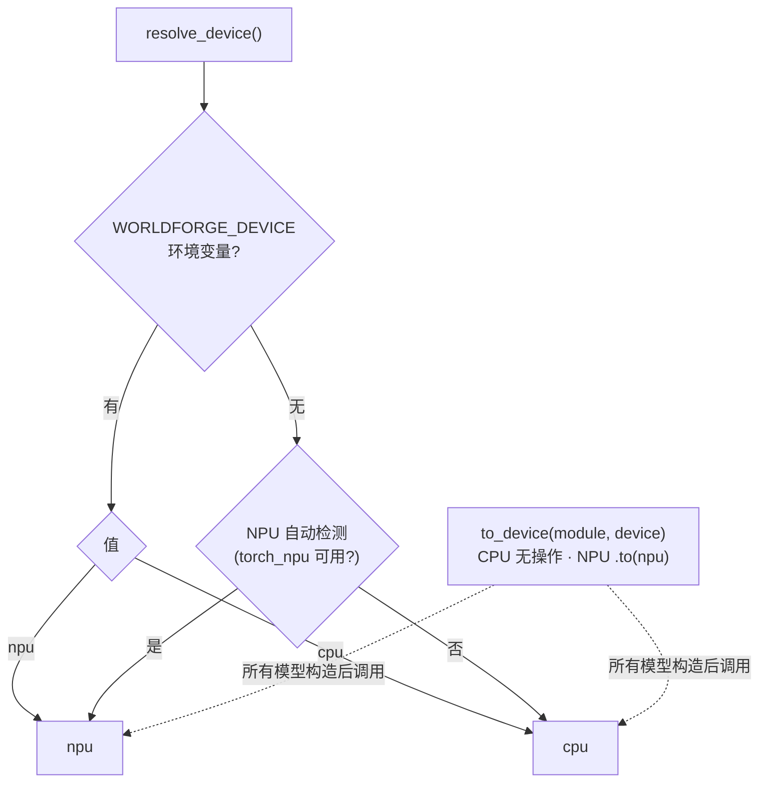

所有模型构造后统一 `to_device(model, resolve_device())`,保证**单一代码路径同时支持 CPU 测试和 NPU 生产**。

### 3.4 版本锁定矩阵(约束 G2)

| 包 | 锁定版本 | 校验 |
|---|---|---|
| torch | 2.9.0 | `npu_env.check_versions(strict=True)` |
| torch_npu | 2.9.0 | 同上 |
| transformers | 4.55.0 | 同上 |
| peft / accelerate | 0.18.0 / 1.14.0 | 同上 |
| vllm / vllm-ascend | 0.18.0 | 同上 |

不匹配抛 `VersionMismatchError`,从根源避免依赖漂移导致的 NPU 兼容性问题。

---

## 4. 训练子系统设计(worldfoundry_train)

### 4.1 模块结构

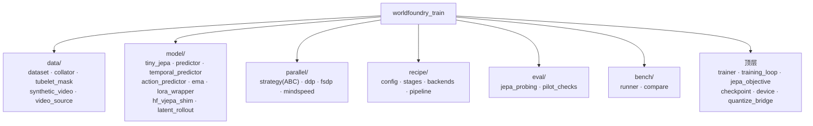

### 4.2 JEPA 训练目标数据流

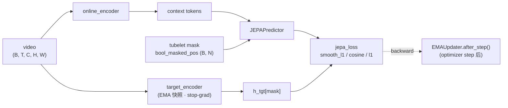

关键约束:

- `target_encoder` 在 `strategy.wrap()` **之前** deepcopy,避免被 FSDP 包裹
- EMA 更新发生在 **optimizer step 之后**(`post_step_hook`),而非每个 micro-batch
- 多 mask 支持(W22.8):`bool_masked_pos_k` 形状 `(B, K, N)`,K 个 mask 独立采样取平均

### 4.3 分布式策略(策略模式)

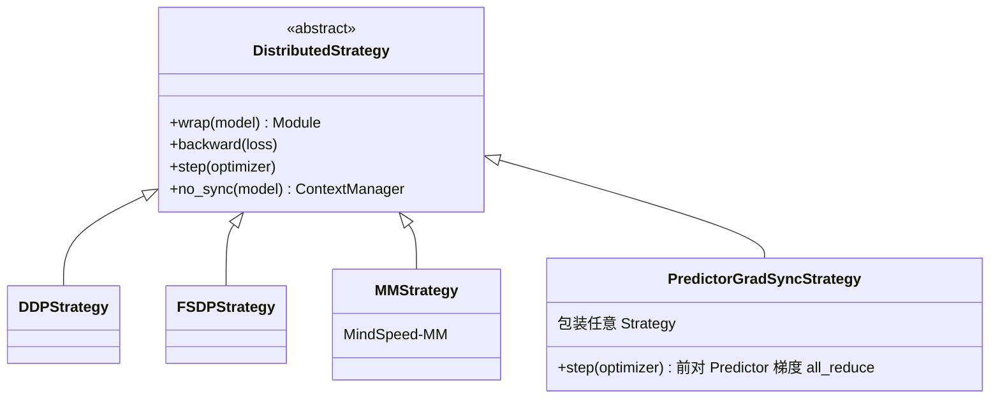

训练循环通过 `strategy.backward(loss)` / `strategy.step(optimizer)` 与具体并行实现解耦。`PredictorGradSyncStrategy` 处理 Predictor(~21M 参数)位于 DDP/FSDP wrap 之外、每 rank 全量副本需要手动梯度同步的问题。

### 4.4 梯度累积语义

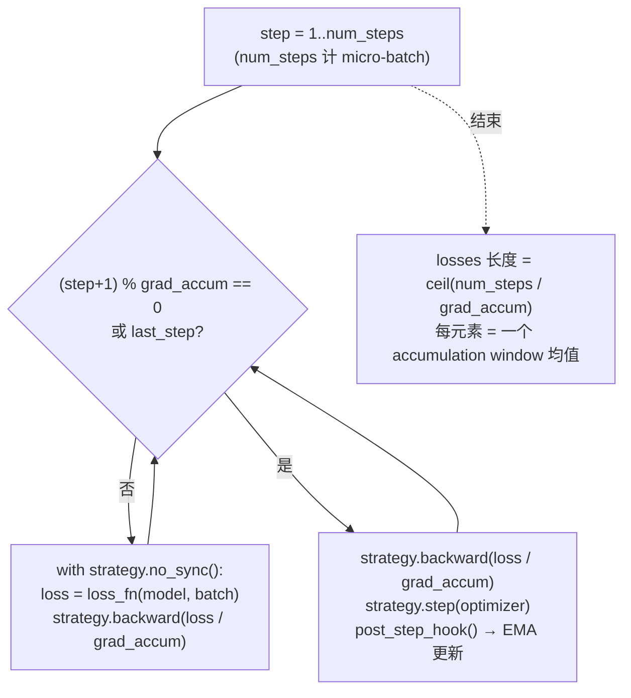

### 4.5 Recipe 流水线(RTI,声明式)

`run_recipe(cfg)` 是后端无关的薄编排:解析 device → 查 stage 注册表 → 按序实例化阶段 → 共享 `RecipeContext` → 写 JSON 摘要。

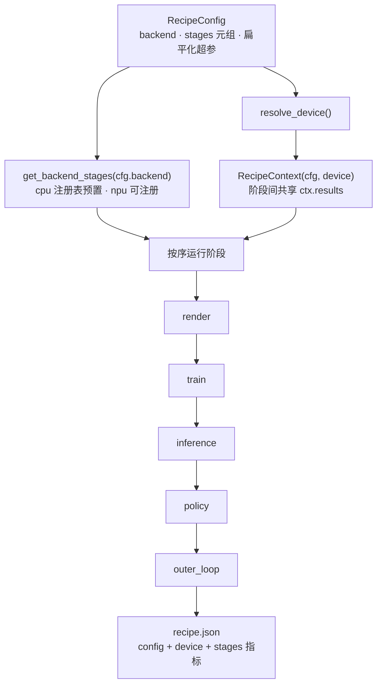

NPU 扩展点:`register_backend("npu", {...})` 注册同契约(`name` + `run(ctx)`)的 stage 类,即可替换整条流水线,无需改动 CPU 路径或 pipeline 代码。

---

## 5. 推理子系统设计(worldfoundry_inf)

### 5.1 服务架构

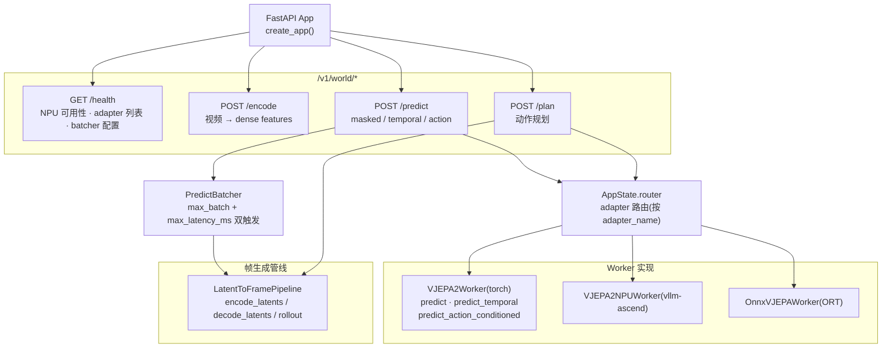

### 5.2 VJEPA2Worker 状态机

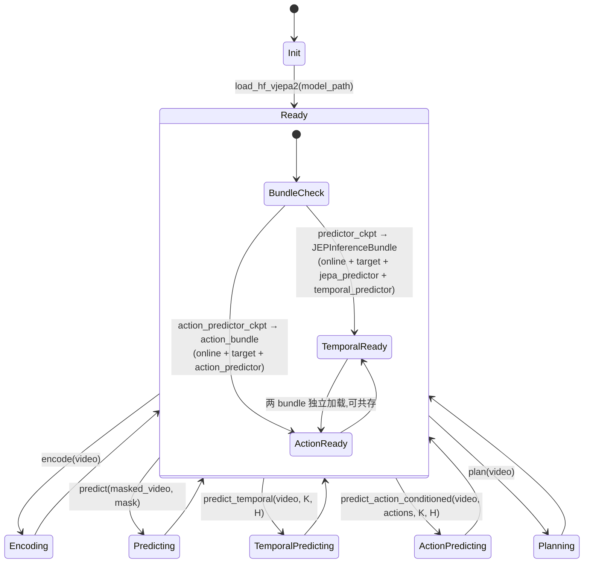

两种 checkpoint 独立加载,worker 可**同时**支持 temporal + action 两种模式。

### 5.3 推理请求时序

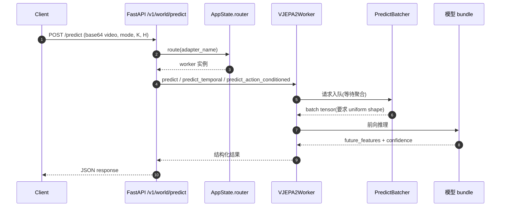

### 5.4 动态批处理(PredictBatcher)

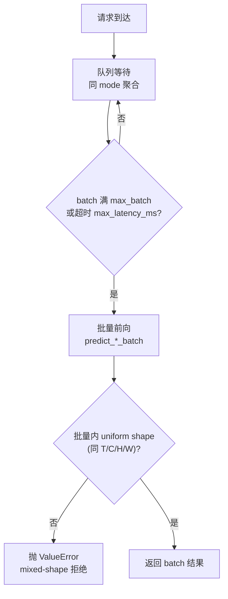

### 5.5 量化编译与帧生成(compile / diffusion / omni)

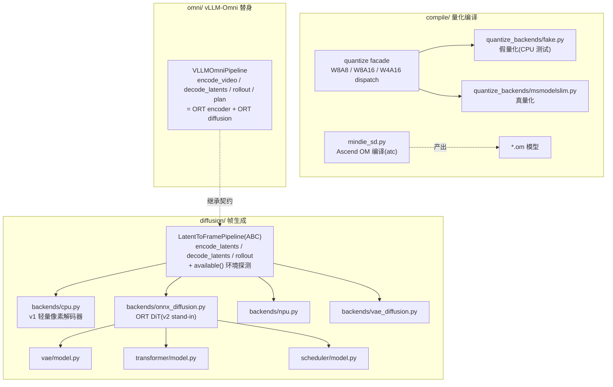

接口冻结:API 端点可在 v1(CPU 像素解码器)与 v2(NPU diffusion)之间**统一 dispatch 而不改调用方**;v1 确定性、v2 随机(自带 RNG)。

**生成型世界模型支持(JEPA 耦合不阻塞)**:帧生成链路 `encode_latents → (action-conditioned latent rollout) → decode_latents / rollout` 中,encoder 与 decoder 是**解耦的两半**——JEPA 训练目标(EMA + masked)只约束训练侧;推理/生成侧**只需 decoder** 即可把 latent(或 latent rollout 预测出的未来 latent)解码为环境/动作预测图像与视频:v1 = CPU 像素解码器,v2 = VAE + DiT + scheduler 扩散解码器(MindIE-SD),均经 `LatentToFramePipeline` 统一 dispatch。因此即使替换/新增任意 encoder(含非 JEPA),复用同一 decoder 即具备生成能力。

---

## 6. RL 子系统设计(worldfoundry_rl)

### 6.1 模块结构

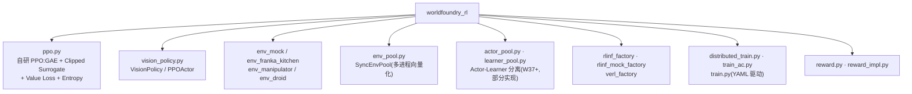

### 6.2 VisionPolicy 编码器策略

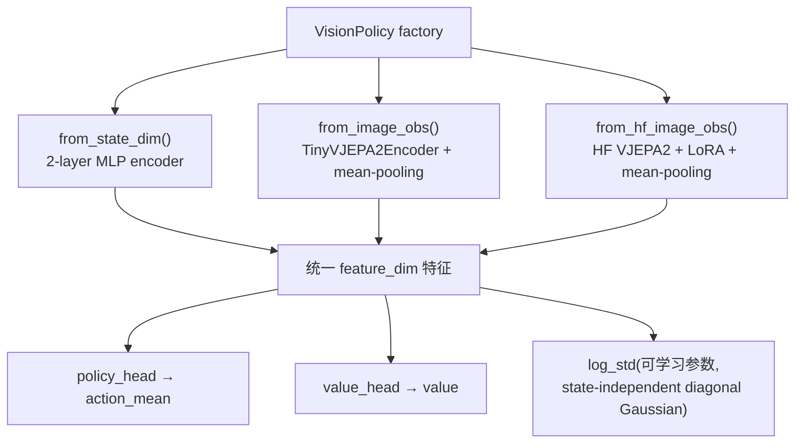

编码器可 freeze(默认)或端到端微调,所有 factory 统一返回 `feature_dim` 维特征。

### 6.3 PPO 训练流程

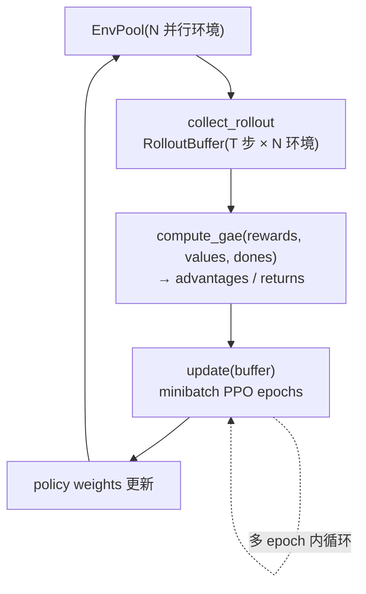

`ppo.py` 自研实现是 **与 verl / RLinf 并列同级的可选 RL 后端**:CLI 三态单选即互斥(`--rl-backend self_ppo(默认) / verl / rlinf`),同时承担 **correctness baseline** 角色——verl/RLinf 必须在同一任务上复现其学习曲线才被采用(零外部依赖,任何环境可用)。

### 6.4 框架接入(rlinf / verl)

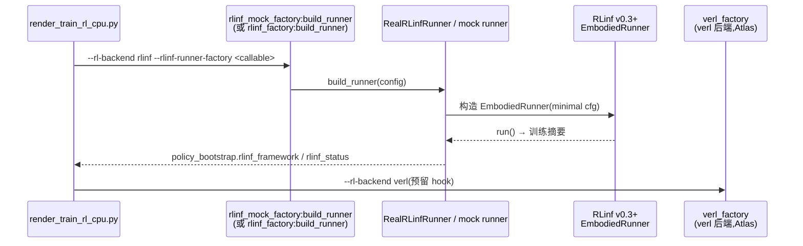

主机 smoke 用 mock 工厂(无需 Ray 集群),Atlas 上走真实 RLinf,dispatch 指纹写入 summary 供审计。

---

## 7. 端到端流程设计

### 7.1 CPU RTI 五阶段流水线(~3.5s 全链路验证)

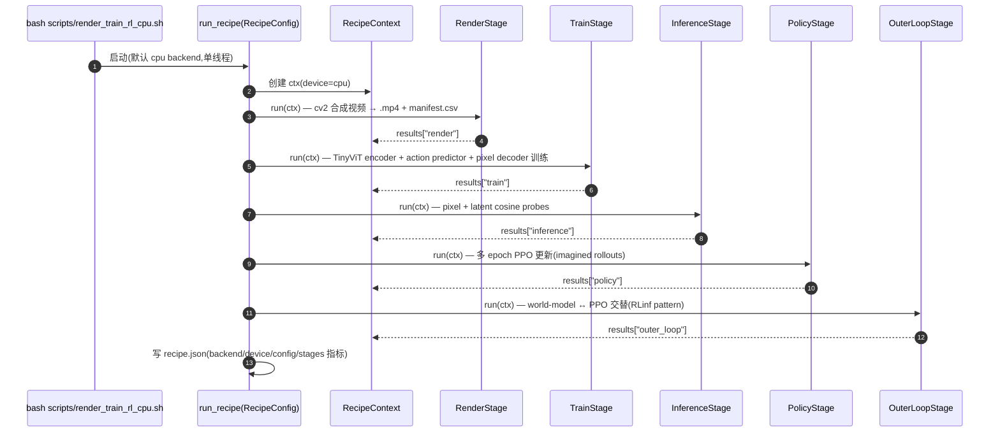

### 7.2 引擎 dispatch 矩阵(编排层)

```mermaid
flowchart TD
    ORCH["scripts/render_train_rl_cpu.py<br/>(四个可插拔后端轴)"]

    AX1{"--inference-backend?"}
    AX1A["torch(默认)<br/>VJEPA2Worker"]
    AX1B["vllm<br/>VJEPA2NPUWorker"]
    AX1C["sglang<br/>SGLang worker"]
    AX1D["vllm_omni<br/>VLLMOmniPipeline(ORT)"]

    AX2{"--rl-backend?"}
    AX2A["self_ppo(默认)<br/>进程内 PPO"]
    AX2B["rlinf<br/>RLinfRunner 适配器"]
    AX2C["verl<br/>预留 hook"]

    AX3{"--frame-gen-backend?"}
    AX3A["none(默认)"]
    AX3B["mindie_sd<br/>LatentToFramePipeline stub<br/>(真 .om 编译 M3-T8)"]

    AX4{"--env / sim_env 轴?"}
    AX4A["mock(默认)<br/>进程内合成环境"]
    AX4B["franka_kitchen / mujoco<br/>dm_control + MuJoCo 真实仿真"]
    AX4C["manipulator / droid<br/>注册表可扩展"]

    ORCH --> AX1
    ORCH --> AX2
    ORCH --> AX3
    ORCH --> AX4
    AX1 --> AX1A
    AX1 --> AX1B
    AX1 --> AX1C
    AX1 --> AX1D
    AX2 --> AX2A
    AX2 --> AX2B
    AX2 --> AX2C
    AX3 --> AX3A
    AX3 --> AX3B
    AX4 --> AX4A
    AX4 --> AX4B
    AX4 --> AX4C
```

每次运行在 summary 中记录 `inference_engine_dispatched` / `policy_bootstrap.rlinf_*` 指纹,下游消费者可审计**实际服务引擎**。

### 7.3 训练数据流

```mermaid
flowchart TD
    SRC["视频文件 / synthetic_video 合成数据"]
    DS["Vjepa2Dataset(manifest.csv 驱动)"]
    COL["collate_vjepa2_batch()<br/>+ tubelet_mask()"]
    PIX["(B, T, C, H, W) pixel_values_videos"]
    MSK["(B, T, Hg, Wg) bool_masked_pos"]
    MOD["model(..., skip_predictor=True)<br/>→ last_hidden_state (B, N_tokens, hidden_dim)"]
    PRED["JEPAPredictor(context_tokens, mask)<br/>→ pred (M, encoder_dim)"]
    TGT["target_encoder(video)<br/>→ h_tgt[mask](stop-grad)"]
    LOSS["jepa_loss = smooth_l1 / cosine / l1"]
    BK["backward + DDP/FSDP all_reduce<br/>+ optimizer.step"]
    EMA["EMAUpdater.after_step()<br/>(每 optimizer step)"]

    SRC --> DS --> COL --> PIX --> MOD
    COL --> MSK --> MOD
    MOD --> PRED
    PRED --> LOSS
    MOD --> TGT
    TGT --> LOSS
    LOSS --> BK --> EMA
```

### 7.4 推理数据流

```mermaid
sequenceDiagram
    autonumber
    participant C as Client
    participant API as FastAPI
    participant W as VJEPA2Worker
    participant B as PredictBatcher
    participant M as 模型

    C->>API: POST /v1/world/predict(base64 video, mode, K, H)
    API->>API: base64 → np.array (T, 64, 64, 3) → tensor (1, T, 3, 64, 64)
    alt mode = masked
        API->>W: worker.predict(video, mask) → features
    else mode = temporal
        API->>W: worker.predict_temporal(video, K, H) → (future_features, confidence)
    else mode = action
        API->>W: worker.predict_action_conditioned(video, actions, K, H) → (future_features, confidence)
    end
    W->>B: 批处理聚合(如启用)
    B-->>W: batch tensor
    W->>M: 前向
    M-->>W: 结果
    W-->>API: 结构化响应
    API-->>C: JSON
```

### 7.5 RL 数据流

```mermaid
flowchart TD
    EP["EnvPool(N 并行环境)"]
    COL["PPO.collect_rollout()<br/>→ RolloutBuffer(T 步 × N envs)"]
    GAE["compute_gae(rewards, values, dones)<br/>→ advantages / returns"]
    UPD["PPO.update()<br/>minibatch SGD over epochs_per_update"]
    W["policy weights 更新 → 下一轮 rollout"]

    EP --> COL --> GAE --> UPD --> W
    W --> EP
```

---

## 8. 部署架构

```mermaid
graph TD
    subgraph HOST["开发/测试主机(CPU)"]
        DEV["pip install -e .[dev,video]<br/>pytest · ruff · CPU RTI smoke(~3.5s)"]
        ORT["onnxruntime(vllm_omni 替身路径)"]
    end

    subgraph ATLAS["Atlas NPU 容器(生产)"]
        IMG["ascend-pytorch:2.9.0-cann8.5.1<br/>torch 2.9.0 + torch_npu 2.9.0"]
        SRV["FastAPI 推理服务<br/>(/v1/world/*)"]
        VLLM["vllm-ascend 0.18.0<br/>VJEPA2NPUWorker"]
        RL["RLinf v0.3+ / verl<br/>(Ray 集群)"]
        QUANT["msmodelslim W8A8<br/>MindIE-SD .om 编译"]
        VAE2["VAE + DiT 扩散管线<br/>(AscendExecutionProvider)"]
    end

    DEV -. 同一份代码 .-> IMG
    IMG --> SRV
    SRV --> VLLM
    SRV --> RL
    SRV --> QUANT
    SRV --> VAE2
    ORT -. Atlas 上自动换 AscendExecutionProvider .-> VAE2
```

关键约束:

- **只**在基础镜像内安装(主机 pip 解析失败:无 torch==2.9.0 wheel)
- 设备解析:host 默认 CPU,Atlas 自动探测 `/proc/driver/npu` 或 `WORLDFOUNDRY_ATLAS=1`
- NPU 专属测试标 `host_skip`,在主机上自动跳过(conftest.py 检测)

---

## 9. 测试策略

| 层 | 规模 | 策略 |
|---|---|---|
| common | ~6 模块 | 适配器契约、后端注册表、NPU 环境、异常 |
| train | ~40+ 模块 | DDP/FSDP smoke、JEPA 目标、EMA、checkpoint、梯度累积、recipe 流水线 |
| inf | ~20+ 模块 | API endpoint、batching、量化 backend、安全、插件注册 |
| rl | ~10+ 模块 | PPO smoke、环境池、策略网络、分布式训练 |

设计原则:

1. **CPU 可运行**:所有核心测试在 CPU 通过,无需 NPU
2. **NPU 隔离**:`host_skip` marker 自动跳过(Atlas 检测: `/proc/driver/npu` 存在 或 `WORLDFOUNDRY_ATLAS=1`)
3. **快速回归**:smoke 测试 <1s,CPU RTI 全链路 ~3.5s

---

## 10. 演进路线与风险

### 10.1 演进路线(roadmap §9.6)

```mermaid
flowchart LR
    P0["P0 本周<br/>host-only 矩阵验证"] --> P1["P1 下周<br/>容器镜像"]
    P1 --> P2["P2 Atlas card 7<br/>vLLM-Ascend / SGLang worker"]
    P2 --> P3["P3 MindIE-SD 真实 .om 链路"]
    P3 --> P4["P4 年度 vllm-omni 重审<br/>(公共 wheel 发布后替换替身)"]
```

### 10.2 风险清单

| 风险 | 说明 | 缓解 |
|---|---|---|
| 包边界泄漏 | `worldfoundry_inf` 直接导入 `worldfoundry_train.model.jepa_inference`,train 包膨胀拖慢 inf 启动 | 协议层收口,懒加载 |
| FSDP + EMA 内存 | target encoder 全量复制在 FSDP 外,大模型显存峰值高 | 已标记与 cpu_offload 互斥(设计 §8.3) |
| Predictor 梯度同步 | `PredictorGradSyncStrategy` 手动 all_reduce 是大规模集群带宽瓶颈 | 集群前 benchmark 验证 |
| 多 mask 计算开销 | K>1 时 predictor 前向 K 次 | encoder 共享,关注 predictor 热点 |
| vllm-omni 依赖 | 公共 wheel 未发布,依赖 ORT 替身 | 接口冻结 + W44+ 重审(P4) |

---

*文档完 — 由 `architecture-analysis.md`(现状分析)推导,图表与代码结构经核对一致。*

