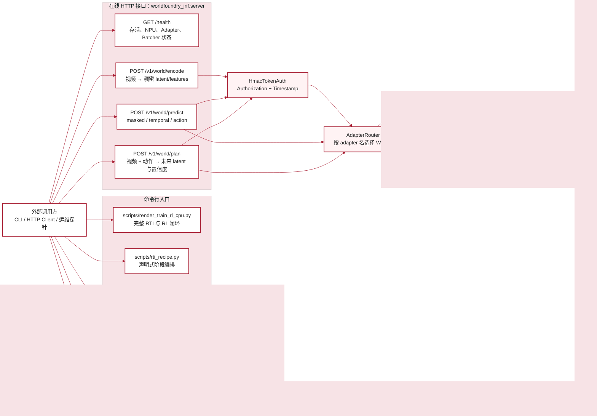
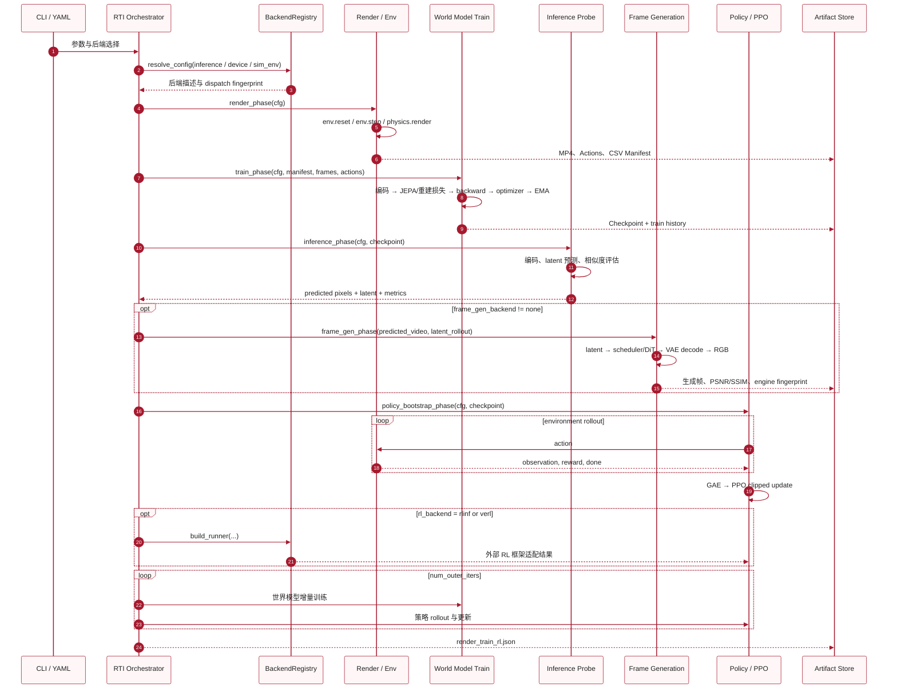
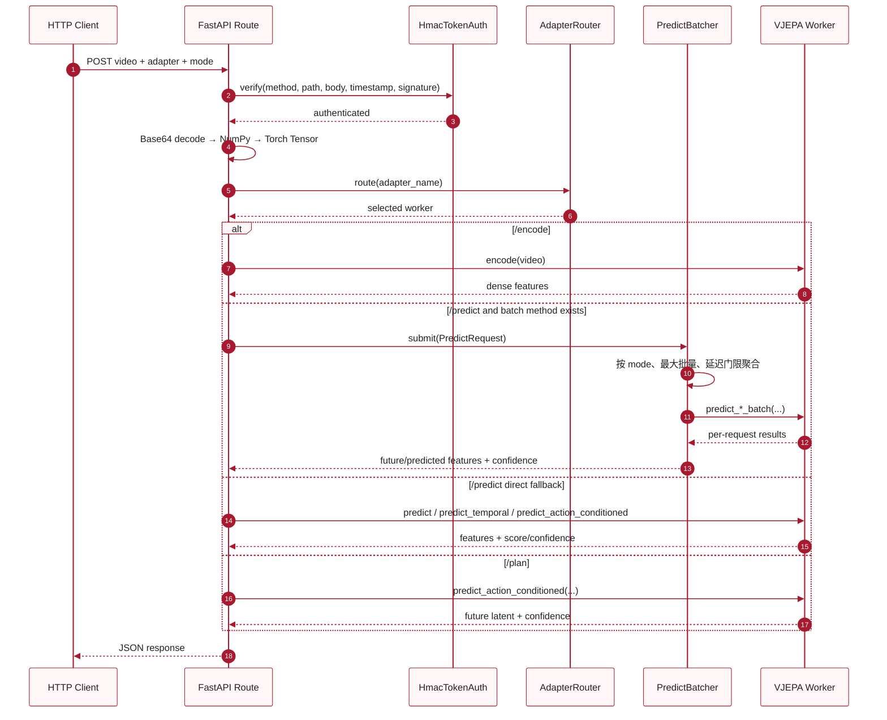
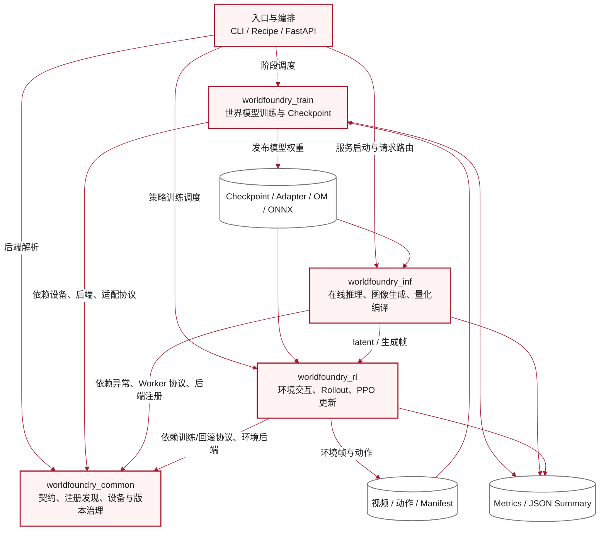
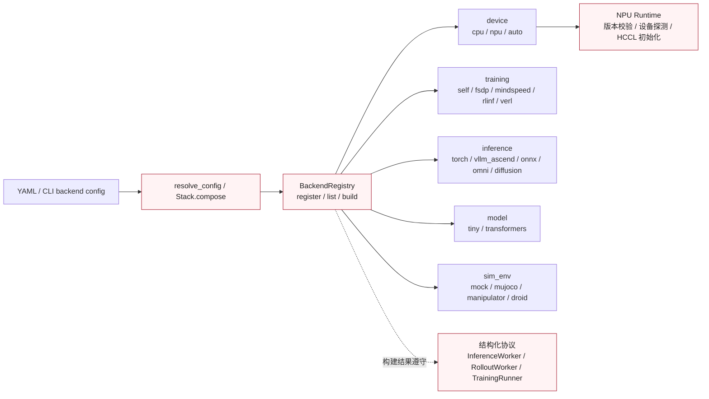
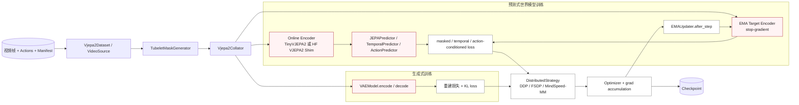
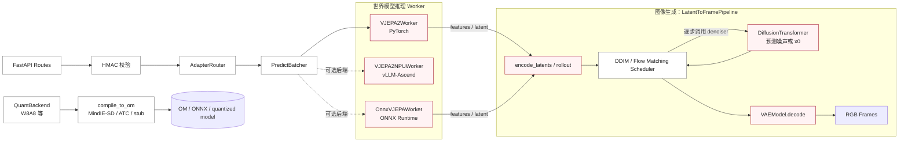
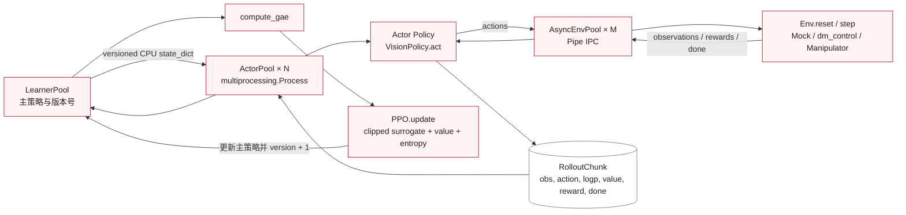

# WorldFoundry 当前代码架构与执行关系

> 分析基线：当前仓库代码，而非路线图目标。  
> 图例约定：红色实线表示当前主调用，红色虚线表示可插拔适配或可选路径，灰色线表示数据/制品传递。

## 1. 代码分析结论

WorldFoundry 当前有两条彼此关联、但执行方式不同的主线：

1. **离线 RTI 主线**：渲染/采集 → 世界模型训练 → 推理评估 → 可选图像生成 → 策略训练 → 世界模型与策略交替更新。
2. **在线推理主线**：HTTP/HMAC → Adapter 路由 → 动态批处理 → 编码、掩码预测、时序预测或动作条件规划。

平台的四个大模块分别承担单一类型的职责：

| 大模块 | 核心能力 | 不应混入该层的概念 |
|---|---|---|
| `worldfoundry_common` | 契约、后端发现、设备解析、版本校验 | 具体训练循环、具体推理算法 |
| `worldfoundry_train` | 数据加工、模型目标、优化、并行策略、Checkpoint | HTTP 服务、仿真进程调度 |
| `worldfoundry_inf` | 在线接口、Worker 路由、批处理、latent 推理、图像生成、量化编译 | PPO 更新、环境 step |
| `worldfoundry_rl` | 环境池、Actor rollout、PPO/GAE、Learner 更新、权重广播 | JEPA/VAE 预训练 |

当前实现的边界也需要明确：

- HTTP 服务公开 `/health`、`/v1/world/encode`、`/predict`、`/plan`；**当前没有 `/render` HTTP 接口**。
- `frame_gen_phase()` 是 RTI 编排中的可选阶段，通过 `LatentToFramePipeline` 执行图像生成。
- `vllm_omni` 当前优先尝试真实 `vllm` 包，但主机上的实际 encoder/diffusion 张量计算仍由 ONNX Runtime Worker/Pipeline 承担。
- RTI 编排选择 vLLM、SGLang 或 vLLM-Omni 时会记录 dispatch fingerprint；针对当前编排器本地训练出的 Tiny/HF 模型，`inference_phase()` 仍走进程内 PyTorch 路径。
- `diffusers` 后端仍是预留项；`MindIE-SD → ATC → stub` 是当前 `compile_to_om()` 的实际优先级。

## 2. 外部接口与提供能力

### HTTP 输入输出语义

| 接口 | 输入 | 提供能力 | 输出 |
|---|---|---|---|
| `GET /health` | 无 | 服务、NPU、Adapter、时序/动作模式、Batcher 状态探测 | 状态 JSON |
| `POST /v1/world/encode` | Base64 视频、可选 `adapter` | 视频编码 | `features`、`shape` |
| `POST /v1/world/predict` | 视频、`mode` 及模式参数 | 掩码补全；未来 latent 预测；动作条件预测 | predicted/future features、score/confidence |
| `POST /v1/world/plan` | 视频、动作序列、过去/未来帧数 | 动作条件规划 | 未来 latent、置信度、动作信息 |

## 3. 离线 RTI 的真实执行顺序

以下顺序直接对应 `scripts/render_train_rl_cpu.py::main()`；可选后端探测发生在正式阶段之前，图像生成位于推理评估之后、策略训练之前。

## 4. 在线推理的真实执行顺序

## 5. 大模块能力与关系

这张图只表达“谁依赖谁、提供什么能力”，不表达执行时序。

## 6. 大模块内部的重要组件

### 6.1 `worldfoundry_common`：统一契约与选择机制

### 6.2 `worldfoundry_train`：两条训练路径与统一优化机制

### 6.3 `worldfoundry_inf`：在线推理与图像生成

### 6.4 `worldfoundry_rl`：Actor–Environment–Learner 闭环

## 7. 自研模块调用第三方开源库的接口与能力

| 自研模块 | 第三方库及接口 | 使用的能力 | 当前状态 |
|---|---|---|---|
| `worldfoundry_common.npu_env`、`worldfoundry_train.device` | `torch_npu`；`torch.npu.is_available()`、`device_count()`、Tensor/Module `.to("npu")` | 昇腾设备发现、设备放置、NPU 张量计算 | 当前生产设备路径 |
| `worldfoundry_common.npu_env`、并行策略 | `torch.distributed.init_process_group(backend="hccl")`、`all_reduce` | 多进程通信、梯度同步 | NPU 用 HCCL，CPU 显式切为 Gloo |
| `worldfoundry_train.parallel.ddp` | `torch.nn.parallel.DistributedDataParallel`、`no_sync()` | 数据并行、梯度累积期间抑制同步 | 已实现 |
| `worldfoundry_train.parallel.fsdp` | `torch.distributed.fsdp.FullyShardedDataParallel` 及 state-dict API | 参数/梯度/优化器状态分片、Checkpoint 汇聚 | 已实现 |
| `worldfoundry_train.parallel.mindspeed` | MindSpeed-MM 包装入口与 PyTorch Optimizer 接口 | 昇腾大模型并行训练接入 | 可选后端、延迟导入 |
| `worldfoundry_train.model.hf_vjepa_shim` | `transformers.VJEPA2Config`、`VJEPA2Model`、`from_pretrained()` | V-JEPA 2 Backbone、HF Hub/本地权重加载 | 已接入；由 shim 统一输出协议 |
| `worldfoundry_train.model.lora_wrapper` | `peft.LoraConfig`、`get_peft_model()` | 对注意力/MLP 线性层实施 LoRA 参数高效微调 | 已实现，并检查非零可训练参数 |
| HF encoder 量化路径 | `torchao.quantization.Int8WeightOnlyConfig`、量化 Tensor 类型 | HF V-JEPA 权重仅 W8 量化 | 可选路径 |
| `worldfoundry_inf.server`、`api/*` | `fastapi.FastAPI`、`APIRouter`、`Request`、`HTTPException`；`uvicorn.run()` | HTTP 路由、依赖注入、错误响应与 ASGI 服务 | 已实现 |
| `worldfoundry_inf.workers.vllm_ascend_worker` | vLLM Worker 基类/模型注册；`vllm-ascend` NPU Platform | 将 VJEPA Worker 接入 vLLM 调度与 Ascend 平台 | Atlas 可选路径 |
| `worldfoundry_inf.omni.pipeline_real` | `vllm.entrypoints.llm.LLM`、构造签名探测 | 真实 vLLM 包接入和运行能力指纹 | 当前主机多为探测；张量计算仍走 ORT |
| `worldfoundry_inf.workers.onnx_vllm_worker` | `onnxruntime.InferenceSession.run()`、Execution Providers | 非 PyTorch encoder 推理；CPU EP 或 Ascend EP | 已实现 |
| `worldfoundry_inf.diffusion.backends.onnx_diffusion` | `torch.onnx.export()`、`onnxruntime.InferenceSession.run()` | DiT/decoder 导出与非 PyTorch 图像生成推理 | 已实现 |
| `worldfoundry_inf.compile.quantize_backends.msmodelslim` | `msmodelslim.MSModelSlim(model).quantize(...)` | W8A8 静态量化、校准数据驱动量化 | Ascend 可选依赖 |
| `worldfoundry_inf.compile.mindie_sd` | `mindie.sd.tools.compile(...)` | 量化模型编译为 Ascend OM | 优先编译路径；依赖可用时执行 |
| `worldfoundry_inf.compile.mindie_sd` | `atc --model ... --framework 5 --soc-version ...` | ONNX → Ascend OM 离线编译 | 次优先真实路径 |
| `worldfoundry_inf.compile.mindie_sd` | JSON metadata writer | 在 MindIE-SD/ATC 均不可用时保留制品契约 | fallback；不是可执行 OM |
| `worldfoundry_inf` 的 `diffusers` backend | `diffusers` 包可用性探测 | 预留 Hugging Face diffusion pipeline 接口 | 当前 `NotImplementedError`，不能算已提供能力 |
| `worldfoundry_rl.env_franka_kitchen` | `dm_control.manipulation.load()`、`env.reset()`、`env.step()`、`env.physics.render()` | MuJoCo 操控任务、奖励、状态与 RGB 渲染 | 已实现，重依赖延迟导入 |
| `worldfoundry_train.data.synthetic_video` | `cv2.VideoWriter` | 合成视频编码并写入 MP4 | 已实现 |
| `worldfoundry_rl.rlinf_factory` | `rlinf.runners.embodied_runner.EmbodiedRunner` | 检查构造签名并尝试构造真实 EmbodiedRunner；完整训练由 `RLinfRunner.run()` 适配面承接 | 依赖 live Ray cluster；构造失败会保留结构化指纹 |
| `worldfoundry_rl.verl_factory` | `verl.trainer.main_ppo.run_ppo`、`is_cuda_available` | 探测真实 verl 入口、签名、文件和运行环境 | 当前 factory 的 `RealVerlRunner.run()` 只记录接入指纹，不直接启动完整 `run_ppo` |
| `worldfoundry_common.adapters.verl.VerlAdapter` | `verl.trainer.main_ppo.run_ppo(cfg)` | 真正调用 verl 的程序化 PPO 入口 | 适配协议已实现；需要完整 verl 配置与运行环境 |
| `worldfoundry_rl.actor_pool`、`env_pool` | Python `multiprocessing.Process`、`Pipe`、`spawn` | Actor 与环境 Worker 多进程隔离、IPC、权重广播 | 已实现的 CPU-faithful 分布式骨架 |

## 8. 阅读图时的层次约束

- **数据**只画成圆柱或数据节点：视频、动作、Manifest、RolloutChunk。
- **模型**只画成模型节点：Encoder、Predictor、DiT、VAE、VisionPolicy。
- **算法/训练范式**只画成处理步骤：JEPA loss、KL loss、GAE、PPO。
- **分布式方法**只作为执行策略：DDP、FSDP、MindSpeed-MM、Actor/Env 多进程。
- **第三方库**只画在系统边界之外，并通过具体 API 名连接自研适配器。

因此，模块图回答“谁提供什么能力”，时序图回答“先执行什么、后执行什么”，第三方表回答“具体调用什么接口获得什么能力”，三类信息不再堆叠在一个框中。
