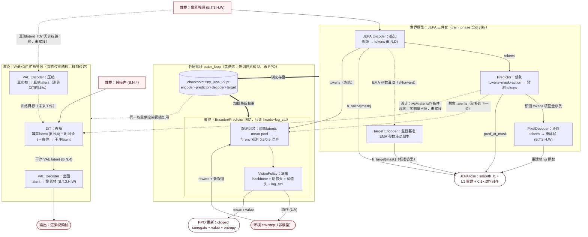

# WF 编排器模型接线图

一次编排器运行（`scripts/render_train_rl_cpu.py`）的 phase 顺序：

```
render_phase → train_phase(JEPA) → iterative_loop_phase ×N（世界模型 continuation → PPO）→ inference_phase → frame_gen_phase
```

所有"分开训练"的模块（世界模型 / 策略 / VAE）靠 **checkpoint** 和**冻结边界**拼接；任何两个可训练组件之间没有共享优化器。环境（env）是唯一非模型的数据源/汇。

## 总图



## 图例

- **实线箭头**：forward 级张量流（一个模型的输出直接是另一个模型的输入）。
- **虚线箭头**：参数级传递（EMA、checkpoint）或**尚未接线的占位路径**（条件注入、VAE 真值 latent）。
- **粗线箭头**：checkpoint 接力（outer_loop 中"先训世界模型 → 存盘 → 策略相加载"）。

## 边清单

| # | 上游 | 下游 | 传递内容 | 语义 |
|---|---|---|---|---|
| 1 | 像素视频 | JEPA Encoder | `(B,T,3,H,W)` | 唯一的原始感官输入 |
| 2 | Encoder | Predictor | tokens `(B,N,D)` + mask + action | 感知结果喂给想象引擎 |
| 3 | Encoder | Target Encoder | EMA 滑动（非 forward） | 参数级复制，产生稳定监督目标 |
| 4 | Target Encoder | JEPA loss | `h_target[mask]` | 预测的"标准答案" |
| 5 | Predictor | PixelDecoder | 预测 token 填回全序列 | 把想象/预测还原成像素（重建监督） |
| 6 | Predictor 想象 latents | VisionPolicy 观测组装 | mean-pool 后 0.5/0.5 混合 | 世界模型→策略核心交接：脑补的下一步作为决策输入 |
| 7 | VisionPolicy | env.step | 动作 `(1,A)` | 环境是回合数据来源（非模型） |
| 8 | 世界模型 ckpt | 策略相 | `tiny_jepa_v2.pt` | outer_loop 接力棒：策略永远消费最新世界模型 |
| 9 | Predictor 未来 latents | DiT 条件口 | `(B,N,64)` | 设计上的渲染交接；**当前为零向量占位** |
| 10 | 纯噪声（Scheduler） | DiT | `(B,N,4)` | 生成起点，与条件共同决定"画什么" |
| 11 | DiT | VAE Decoder | 干净 latent `(B,N,4)` | 潜空间→像素最后一跳 |
| 12 | 真实视频 | VAE Encoder | `(B,3,H,W)` 逐帧 | 只为产真值 latent（训练 DiT 的目标），推理时不参与 |
| 13 | HF Encoder（服务路径） | Temporal / ActionConditioned Predictor | tokens `(B,N,1024)` | `predict_temporal`（K→H）/ `predict_action_conditioned`（K 帧+K 动作→H） |
| 14 | Encoder latent + 当前动作 | LatentActionHead | concat `(B,D+A)` | AC 微调路径：预测下一动作 |

## 三个拼接方式

1. **张量直连**：上表大部分边。典型是 #6——策略每走一步，冻结的 Predictor 先按假想动作外推下一时刻 latents，与 env 真实观测混合后作为新观测（策略"活在世界模型的想象里"）。
2. **参数级拼接**：EMA（Encoder→Target Encoder）与 checkpoint（世界模型→策略相/渲染管线）。"哪个模型最新"靠 checkpoint 传播，不靠同一次 forward。
3. **零参数组合器**：`LatentRolloutPlanner` 把 Encoder+Predictor+Decoder 串成"编码→外推→渲染→再编码"的多步想象闭环；`Scheduler` 管理噪声/时间步。它们无自有参数，只决定数据在模型间怎么转。

## 现状与待接线（如实标注）

- 渲染管线中 **DiT 条件为零向量占位**（`vae_diffusion.py` rollout），世界模型 latents → 扩散条件尚未接通；
- **VAE 与 DiT 权重均为随机初始化**：`VAEDiffusionPipeline` 构造时不加载 ckpt（`train_vae.py` 的训练产物只在独立评测脚本中加载）；
- **DiT 无训练路径**。语义闭环三步：VAE 权重接入管线 → 接通 JEPA 条件 → 训练 DiT。

> 相关文档：包/接口级架构见 `current-code-architecture-mermaid.md`；设计叙述见 `architecture-design.md`。
